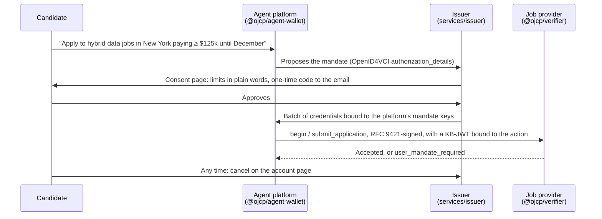

# OJCP credentials

Open-source building blocks for the credential side of OJCP: an agent applying for jobs **on a candidate's behalf, within limits the candidate approved once**, employers verifying that it did, and people proving facts about their work history from a wallet.

It implements, as drafted:

- standing mandates ([RFC 0008](https://github.com/ojcp-org/ojcp/pull/40)), with occupation codes and binding actions from [RFC 0009](https://github.com/ojcp-org/ojcp/pull/46);
- action mandates and agent identity (spec *User Mandates* and *Agent Identity*, RFC 0003);
- decentralized provider trust: organization identity keys, attestations, key-pinned trust lists and effective tiers ([RFC 0010](https://github.com/ojcp-org/ojcp/pull/41));
- hiring credentials and their issuer profile ([RFC 0014](https://github.com/ojcp-org/ojcp/pull/45)) and their presentation to employers ([RFC 0013](https://github.com/ojcp-org/ojcp/pull/44)).

How the RFCs fit together: [Discussion #53](https://github.com/ojcp-org/ojcp/discussions/53).

> **Status: working code, unreleased.** It tracks RFCs still in their comment period (closing November 11, 2026), so formats will change with them. Nothing is published to npm yet.

## What's here

| Path | What it is | Who uses it |
|---|---|---|
| [`sdks/typescript/agent-wallet`](sdks/typescript/agent-wallet) · `@ojcp/agent-wallet` | Agent platform library: request-signing and mandate keys with the key directory, RFC 9421 signed `fetch`, an MCP client that signs every call, standing-mandate batches over OpenID4VCI, deciding what a mandate covers and what to disclose, action-mandate presentation. No UI. | Agent platforms |
| [`sdks/typescript/verifier`](sdks/typescript/verifier) · `@ojcp/verifier` | Provider library: RFC 0008 §8 standing-mandate verification with the per-employer count, action-mandate verification, RFC 0013 §6.2 validation of wallet presentations, status-list cache. Every mandate refusal is `user_mandate_required`. | Job boards, ATSs, career sites |
| [`sdks/typescript/trust`](sdks/typescript/trust) · `@ojcp/trust` | RFC 0010 for agents: manifest and key-certificate checks, attestation validation (pinned JWK or X.509 anchor), trust lists with rollover and sticky distrust, status, tier derivation with the two-operator rule, display text. Its resolver plugs into the agent wallet. Also the attester and list-publisher signing helpers. | Every agent; attesters, list publishers, indexes |
| [`sdks/typescript/core`](sdks/typescript/core) · `@ojcp/credentials-core` | Shared primitives: keys and `Signer`, JWS, SD-JWT (RFC 9901), OJCP digests (JCS), RFC 9421 signing profile, O*NET-SOC hierarchy, salary grid, scope coverage, Token Status Lists, the hiring credential types and their Type Metadata. | All the libraries |
| [`services/issuer`](services/issuer) · `@ojcp/issuer` | Self-hostable issuer service: OpenID4VCI authorization server and credential issuer, consent page, account page for revocation, status lists, and the RFC 0014 record API with former-employee offers. Hono, SQLite. | Mandate issuers; HR platforms, employers and schools issuing records |
| [`services/sandbox`](services/sandbox) · `@ojcp/sandbox` | A test-only OJCP world told as one story in five persona tabs: an HR platform issuing an employment record; the candidate's wallet, whose provider also runs the permission service; JobGPT, a ChatGPT-style assistant applying under that permission; an employer verifying the record and receiving the application; and under the hood. Every party on its own origin. Runs locally on `*.sandbox.lvh.me`; deploys to `*.sandbox.ojcp.dev`. Test keys and made-up data only. | Anyone evaluating the protocol; providers checking conformance |
| [`vectors`](vectors) | Language-neutral test vectors: digests, O*NET containment, salary rungs, scope coverage, Type Metadata bytes, and signed standing-mandate verification cases with expected outcomes. | Every SDK, in every language |
| [`data/onet`](data/onet) | O*NET-SOC 2019 taxonomy and SOC structure (CC BY 4.0), compiled to one JSON every SDK loads. | Every SDK |

TypeScript comes first. Python and Kotlin SDKs follow under `sdks/`, each native to its ecosystem and held to the same `vectors/`.

No OJCP-run issuer exists or is planned: anyone can run `services/issuer`, and providers decide which issuers they admit.



## Use

Node 22.13 or later, pnpm.

```bash
pnpm install
pnpm test          # unit, end-to-end and vector tests
pnpm typecheck
pnpm build
```

Run the issuer locally:

```bash
pnpm build
OJCP_ISSUER_URL=http://localhost:8787 PORT=8787 \
OJCP_SIGNING_KEY="$(cat key.json)" OJCP_SIGN_UNTIL=1830000000 \
OJCP_CLIENTS_FILE=clients.json OJCP_POLICY_URI=http://localhost:8787/practice \
OJCP_COOKIE_SECRET=<32+ chars> OJCP_ADMIN_TOKEN=<32+ chars> \
node services/issuer/dist/main.mjs
```

`key.json` is a private P-256 JWK; `clients.json` lists the agent platforms allowed to request mandates (see [`services/issuer/README.md`](services/issuer/README.md)).

Run the sandbox locally, then open `https://hr.sandbox.lvh.me:8443/` and follow the steps:

```bash
pnpm --filter "@ojcp/sandbox..." build
pnpm --filter @ojcp/sandbox local
```

See [`services/sandbox/README.md`](services/sandbox/README.md) for what it shows and how to deploy it.

## Docs

- [Architecture](docs/architecture.md): packages, modules, interfaces, data flows
- [RFC mapping](docs/rfc-mapping.md): every requirement and where it is implemented and tested
- [RFC feedback](docs/rfc-feedback.md): gaps and ambiguities found while implementing
- [Roadmap](docs/roadmap.md): what's done, what's next
- [Prior art](docs/prior-art.md): AP2, credential SDKs, standards work
- [Decisions and open questions](docs/open-questions.md)

## Principles

- **Open source, neutral home.** `ojcp-org`, Apache-2.0, like the conformance suite.
- **Standards first.** SD-JWT VC, OpenID4VCI 1.0, Token Status List and RFC 9421 as pinned by HAIP; P-256 keys and SD-JWT key binding as in AP2, so one holder can carry both.
- **No central party.** Anyone can run an issuer; providers decide whom to admit.
- **Same answers in every language.** Behaviour is pinned by `vectors/`, not by one implementation.
