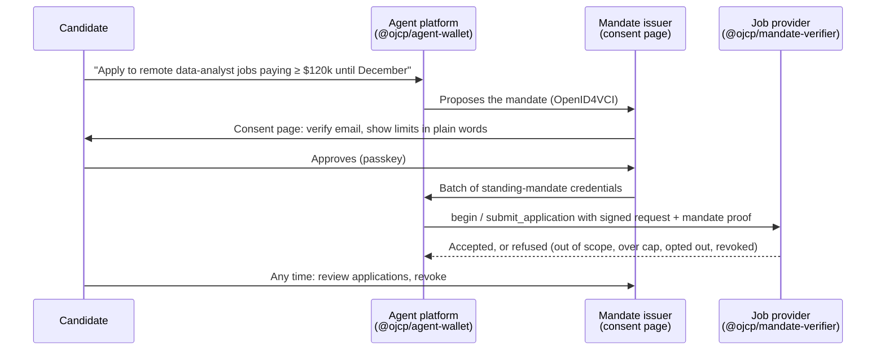

# OJCP Agent Wallet

Open-source tooling that lets a candidate's AI agent apply for jobs **on the candidate's behalf, within limits the candidate approved once**, and lets employers verify that it did.

It implements the agent and issuer sides of OJCP's draft standing-mandate design ([RFC 0008](https://github.com/ojcp-org/ojcp/pull/40)), which builds on occupation codes and binding actions ([RFC 0009](https://github.com/ojcp-org/ojcp/pull/46)) and decentralized provider trust ([RFC 0010](https://github.com/ojcp-org/ojcp/pull/41)), with wallet credentials ([RFC 0013](https://github.com/ojcp-org/ojcp/pull/44), [RFC 0014](https://github.com/ojcp-org/ojcp/pull/45)) later. How the RFCs fit together: [Discussion #53](https://github.com/ojcp-org/ojcp/discussions/53).

> **Status: planning.** Nothing here is released. Everything tracks RFCs that are still in their comment period (closing November 11, 2026), so names and formats will change with them.

## What it is

Not an app. Three pieces, by who uses them:

| Piece | What it is | Who runs it |
|---|---|---|
| **`@ojcp/agent-wallet`** | A TypeScript library inside the agent platform's backend. Holds the platform's mandate keys and its users' standing mandates, decides whether a job is covered, and attaches the proof to each application. No user interface. | Agent platforms (auto-apply tools, assistants) |
| **Reference mandate issuer** | A small, self-hostable web service: the consent page where a person approves "apply for me within these limits", plus a dashboard to see applications and revoke. | Agent platforms, identity or wallet providers, or neutral operators. OJCP itself runs none in production. |
| **`@ojcp/mandate-verifier`** | A TypeScript library for job providers: the RFC 0008 §8 verification steps and the per-employer count. | Job boards, ATSs, employer career sites |

Phone wallets for job and degree records (RFC 0013/0014) come from existing wallet providers; this project integrates with them rather than building one.

## Docs

- [Architecture](docs/architecture.md): components, modules, interfaces, data flows
- [RFC mapping](docs/rfc-mapping.md): every RFC 0008 requirement and where it lives
- [Roadmap](docs/roadmap.md): milestones, acceptance criteria, dependencies
- [Prior art](docs/prior-art.md): AP2, existing credential SDKs, standards work
- [Decisions and open questions](docs/open-questions.md): what's settled, and what to settle before building

## Principles

- **Open source, neutral home.** Lives in `ojcp-org`, Apache-2.0, like the conformance suite. It lowers the cost of adopting the RFCs; it is not a product with a toll booth.
- **Reuse, don't reinvent.** Built on OpenWallet Foundation libraries (SD-JWT, OpenID4VCI), `jose`, and Cloudflare's RFC 9421 implementation. The new code is the hiring layer.
- **No central party.** Anyone can run an issuer; providers decide which issuers they admit.
- **Tested against the spec.** Every rule in RFC 0008's conformance table is a shared fixture in `@ojcp/conformance`.
