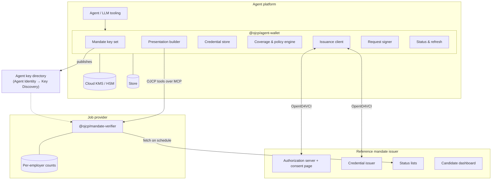

# Architecture

Section references (§) are to [RFC 0008](https://github.com/ojcp-org/ojcp/pull/40) unless stated otherwise.

## Roles

RFC 0008 assigns the OpenID4VCI roles like this (§3.1):

| OpenID4VCI role | Who |
|---|---|
| Credential Issuer and Authorization Server | The **mandate issuer** |
| Wallet (holds credentials) | The **agent platform**, not the person |
| End-User | The **candidate**, who authenticates at the issuer and approves the consent page |

That's why the core is a server-side library: the agent platform holds the credentials and keys on behalf of all its users.

## Components

## `@ojcp/agent-wallet` modules

| Module | Responsibility | RFC 0008 |
|---|---|---|
| **Mandate key set** | Create, publish and retire the platform's pool of ≥ 32 P-256 mandate keys, shared by all users; mark each with `ojcp_mandate_until`; never bind a key published less than 7 days ago; keep keys non-exportable | §3.4, §7.4 |
| **Issuance client** | Propose a mandate in an OpenID4VCI `authorization_details` entry carrying `ojcp_standing_mandate`; request batches with one proof per key from a random subset of the key set; record `applications_total` and the salary floor returned in the token response | §3.1, §3.2, §3.4 |
| **Credential store** | Hold each user's batches; enforce which credential is used where: one per (resource server, employer) for application actions, fresh ones for search, never one credential at two resource servers | §4.1 |
| **Coverage & policy engine** | Before any application: is the job covered (O*NET hierarchy, location, remote policy, employment type, experience level, salary rung)? Is `binding_actions` present and empty? Is the provider's RFC 0010 tier at least `verified` and the mandate's trust floor? Is the user's overall total and own per-employer count respected? Stop and ask the user otherwise | §2.2, §2.4, §5.1–5.3, §6.3 |
| **Presentation builder** | Choose disclosures (exactly one `candidate` element; the covering job-family, location, remote-policy and action elements; the highest salary rung not above the posting's low end); build the KB-JWT with `aud`, `nonce`, `sd_hash` and `ojcp_action` = `sha256:` + base64url(SHA-256(JCS(action statement))) | §2.1, §2.3, §4.2 |
| **Request signer** | RFC 9421 signatures with `keyid` = the `cnf` key thumbprint, nonce shared with the KB-JWT, idempotent retries for `submit_application` | §4.2, §4.3 |
| **Status & refresh** | Watch its own credentials' status; refresh batches before they run out (OpenID4VCI §14.5) on identical terms; re-ask the user for anything else | §7.1–7.3 |
| **MCP client helper** | Wrap `@modelcontextprotocol/sdk` tool calls so the agent declaration, signature and mandate proof are attached automatically | — |
| **Activity log** | A per-user record of what was applied for, under which mandate, for the dashboard and for the user's own records | — |

### Pluggable interfaces

| Interface | Implementations |
|---|---|
| `Signer` | In-memory (tests), OS keychain / Secure Enclave (local agents), AWS KMS / Google Cloud KMS (hosted agents). ES256 only for mandate keys. |
| `Store` | In-memory (tests), SQLite (single process), Redis / Cloudflare KV (distributed). Holds credentials, nonces, counters, cached status lists. |
| `TrustResolver` | Derives a provider's effective tier under RFC 0010 source (a). Until 0010 has an implementation, only a test resolver exists (see Roadmap). |
| `Classifier` | O*NET-SOC 2019 hierarchy lookups for job-family coverage (bundled data). |

## Reference mandate issuer

A small web service, deployable by anyone:

- **Authorization server and consent page.** Authorization code flow with `authorization_details`. Verifies each candidate identifier (email or phone by one-time code, or proof of possession for a `jkt`). Renders the consent page from a locally pinned copy of the Type Metadata matching `vct#integrity`, with every element §3.3 lists, in plain language.
- **Credential issuer.** Validates every proof key against the agent's key directory, `ojcp_mandate_until` and the 7-day rule; computes salary rungs from the grid (§2.2); pads allow-lists with decoys to the fixed lengths (§2.5); issues batches with distinct salts, signatures and status indexes.
- **Status lists.** Each batch spread across several lists, each list shared by many users; changes applied at fixed epochs of at most one hour; lists served from a CDN-friendly path.
- **Dashboard.** The candidate sees active mandates and the agent's reported activity, and revokes (all credentials of the authorization, including refreshed batches).

## `@ojcp/mandate-verifier`

For providers on Node or edge runtimes. Implements §8 in order (holder proof, admission, audience and time, action and scope, status, replay and count, session binding), fails closed with `user_mandate_required`, and keeps the per-employer count keyed by HMAC of employer and candidate binding (§6.1). Providers on the JVM (for example, the Recruitics provider via `ojcp-java-sdk`) implement the same steps against the same fixtures.

## Libraries

| Need | Package |
|---|---|
| SD-JWT and SD-JWT VC | `@sd-jwt/core`, `@sd-jwt/sd-jwt-vc` (OpenWallet Foundation) |
| Token Status List | `@sd-jwt/jwt-status-list` |
| OpenID4VCI client and server | `@openid4vc/openid4vci`, `@openid4vc/oauth2` (OpenWallet Foundation `oid4vc-ts`) |
| Presentation queries (RFC 0013 later) | `dcql` |
| JWT and keys | `jose` |
| RFC 9421 request signatures | `http-message-sig` (Cloudflare `web-bot-auth`) |
| JSON canonicalization (RFC 8785) | `canonicalize` |
| MCP | `@modelcontextprotocol/sdk` |
| Schema validation | `ajv` with the schemas from `@ojcp/conformance` |

Toolchain: TypeScript, ESM-only, pnpm workspaces, tsdown, vitest, npm trusted publishing. Same as `@ojcp/conformance`.

## Security notes

- **Keys.** Mandate keys are shared across all of a platform's users by design (§3.4): a per-user key would be a cross-provider identifier. Candidate binding, not the key, limits each credential to its own candidate.
- **Fail closed in the agent too.** The provider checks scope, but the wallet checks it first and refuses to begin an uncovered application. Binding actions, EEO answers and anything that records assent always go back to the person (§5.1, §5.2).
- **No cross-employer counting service.** The user's overall total is enforced only by the agent (§6.3). The activity log stays with the agent platform and the issuer dashboard, never a shared service.
