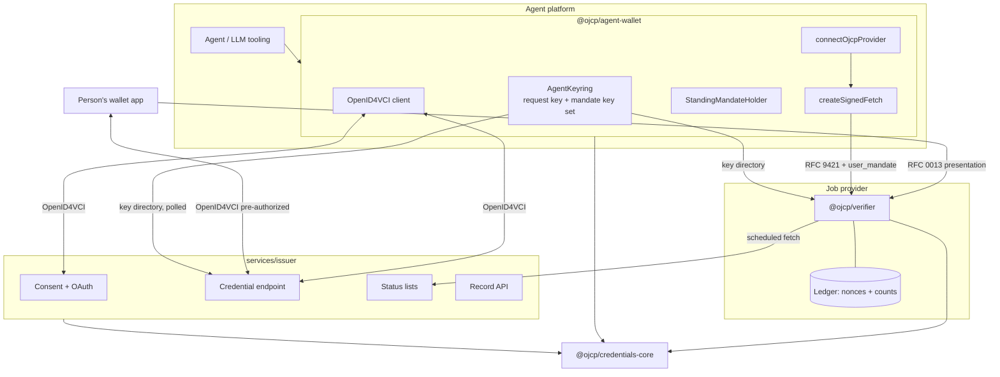

# Architecture

Section references (§) are to [RFC 0008](https://github.com/ojcp-org/ojcp/pull/40) unless stated otherwise.

## Roles

RFC 0008 assigns the OpenID4VCI roles like this (§3.1):

| OpenID4VCI role | Who |
|---|---|
| Credential Issuer and Authorization Server | The **mandate issuer** (`services/issuer`) |
| Wallet (holds credentials) | The **agent platform** (`@ojcp/agent-wallet`), not the person |
| End-User | The **candidate**, who proves an email or phone and approves the consent page |

That is why the agent wallet is a server-side library: the platform holds credentials and keys for all its users. Hiring credentials (RFC 0014) go the other way: they are held in the **person's own wallet app** and presented straight to the employer (RFC 0013); the agent never sees them.

## Packages

### `@ojcp/credentials-core`

| Module | Contents |
|---|---|
| `keys`, `jws`, `encoding`, `digest` | The `Signer` interface (WebCrypto, or any HSM/KMS behind it), RFC 7638 thumbprints, compact JWS with the algorithm taken from the key, JCS and the OJCP `sha256:` digest |
| `sd-jwt` | RFC 9901 issuance with exact decoy padding and order-hiding (or order-keeping) arrays, strict parsing and reconstruction, selective presentation by predicate or DCQL claim path, KB-JWTs with extra claims |
| `agent-identity` | The spec's RFC 9421 signing profile (`created`, `expires` ≤ 300 s, `nonce`, `keyid`, `tag=web-bot-auth`, `Content-Digest`), verification with the spec's error codes, `agent_id` grammar, namespace and delegated binding |
| `action` | Action statements, `candidate_data_digest`, `binding_actions_digest` |
| `mandate/*` | The standing-mandate model and claim builder, the disclosure rule and padding checks, the salary grid, scope coverage |
| `onet` | O*NET-SOC 2019 hierarchy containment (never string prefix; residual "All Other" only exact) |
| `hiring/types`, `vct` | The four RFC 0014 types (issue and presented schemas), coarse claims, lifetime caps, `basis`; Type Metadata and `vct#integrity` |
| `status-list` | Token Status Lists with ≥ 10,000 entries and unpredictable indexes |
| `wire` | zod schemas for the OJCP shapes consumed (job facts, binding actions, agent declaration, `auth.user_mandates`) |

### `@ojcp/agent-wallet`

| Module | Responsibility | RFC 0008 |
|---|---|---|
| `AgentKeyring` | Request-signing key; mandate key set of ≥ 32 shared P-256 keys with `ojcp_mandate_until`; eligibility (published ≥ 7 days, valid past `exp`); key directory document | §3.4, §7.4 |
| OpenID4VCI client | `beginStandingMandate` (PKCE, `authorization_details`), `completeStandingMandate`, `refreshStandingMandate`; one proof per randomly chosen eligible key | §3.1, §3.2, §7.3 |
| `StandingMandateHolder` | Credential choice (one per resource server and employer; fresh for search; never across resource servers), coverage on the full scope, trust floor from RFC 0010 source (a) only, binding actions and EEO fail closed, the user's total and own per-employer count, disclosure choice, KB-JWT with `ojcp_action` | §2.2–2.3, §4, §5, §6.3 |
| `createSignedFetch` | Signs every request; for a call carrying a standing mandate, signs with the `cnf` key and reuses the KB-JWT nonce (except `submit_application`) | §4.2 |
| `connectOjcpProvider` (`@ojcp/agent-wallet/mcp`) | MCP client over the signed fetch | — |
| Action mandates | Statement for approval; presentation with a KB-JWT by the agent key | spec *User Mandates* |
| `TrustResolver` | Interface only: the wallet consumes an effective tier and its source; deriving tiers belongs to RFC 0010 | §5.3 |

### `@ojcp/verifier`

| Export | Responsibility |
|---|---|
| `verifyStandingMandate` | §8 steps 1–6. Returns a decision to bind to the session (step 7); for submissions, a `commit()` that atomically consumes `mandate_nonce` and records the count |
| `verifyActionMandate` | Spec *User Mandates → Verification*: digest or embedded statement, `cnf.jkt`, lifetime, status or single use, `jti` and `mandate_nonce` consumption |
| `verifyHiringPresentation` | RFC 0013 §6.2 steps 2–5 for `dc+sd-jwt`: pinned keys and signing windows, accepted issuer/type/profile/basis, time, holder binding, status, dropping unrequested claims; `contactMatches` for the §3 confirmation |
| `StatusListCache` | Scheduled, verified status-list copies with a maximum age; injectable fetch (for an Oblivious HTTP relay) |
| `MandateLedger` | Interface plus an in-memory implementation; the count key is HMAC under a per-employer secret |
| `MandateRejected` | `toToolError()` gives the wire error; the failure class stays internal |

### `services/issuer`

`Issuer` holds the protocol logic; `createApp` is a thin Hono layer; `IssuerStore` has in-memory and SQLite (`node:sqlite`) implementations. Status lists, their used indexes and queued changes are persisted, so restarts never forget a revocation. Integrations a deployment supplies: `Messenger` (webhook in production), `MandateKeySource` (polls agent key directories and records first-seen times).

## Libraries

| Need | Choice |
|---|---|
| SD-JWT | Own implementation in core: RFC 0008 needs exact padding, the disclosure rule on the raw payload, and KB-JWT extra claims. Interoperability is tested against the OpenWallet Foundation's `@sd-jwt/sd-jwt-vc` in both directions. |
| Token Status List | `@owf/token-status-list` |
| RFC 9421 | `http-message-sig` (Cloudflare) |
| JWK thumbprints | `jose` |
| JCS (RFC 8785) | `canonicalize` |
| Validation | `zod` 4 |
| HTTP | `hono`, `@hono/node-server` |
| MCP | `@modelcontextprotocol/sdk` (optional peer dependency) |

Toolchain: TypeScript 7, ESM only, pnpm workspaces, tsdown, vitest, Biome. Sources run directly in development through the `source` export condition.

## Several languages

Each language gets a native SDK under `sdks/<language>/`, built on that ecosystem's libraries. Consistency comes from `vectors/` and `data/onet/`, generated by `scripts/` and checked by every SDK's tests, not from sharing one implementation.

## Security notes

- **Keys.** Mandate keys are shared across a platform's users by design (§3.4); candidate binding limits each credential to its own candidate.
- **Fail closed in the agent too.** The holder refuses before the provider would: uncovered jobs, binding actions, EEO, trust below the floor or not derived.
- **Nothing reveals which check failed.** Every mandate refusal on the wire is `user_mandate_required`, with `details.reason` only for the two policy-dependent cases.
- **No cross-employer counting.** The user's total lives with the agent; providers count per employer, keyed by an HMAC they can't join across employers.
